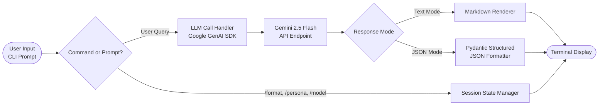

# Project 1 — Simple AI Agent (Gemini)

An interactive, extensible Command-Line Interface (CLI) AI agent built in Python using the official **Google GenAI SDK** (`google-genai`), powered by **`gemini-2.5-flash`**.

---

## 1. Architecture Overview

The agent follows a clean **Read-Eval-Print Loop (REPL)** design pattern:



### Request Flow
1. **User Input**: Read via the terminal with prompt validation and empty-input protection.
2. **Session Command Dispatcher**: Intercepts slash commands (`/help`, `/format`, `/persona`, `/model`, `/exit`) to modify session configuration without restarting.
3. **LLM Engine**: Dispatches user prompts to Google Gemini via `genai.Client.models.generate_content`, applying the active system instruction (persona) and generation configuration.
4. **Structured Parser / Renderer**: Emits formatted Markdown or strict Pydantic-validated JSON.

---

## 2. Key Concepts Explained

### A. Python & Modern Environment Management
- **Virtual Environments (`venv`)**: Isolate project-specific dependencies (`google-genai`, `python-dotenv`, `pydantic`, `rich`) from your global Python installation, preventing version collisions.
- **Environment Variables & `python-dotenv`**: Separates sensitive credentials (API keys) from source code, complying with 12-factor application security best practices.
- **CLI Design (`argparse`)**: Provides a native command-line interface with flags (`--model`, `--persona`, `--json`, `--query`) and automated `--help` documentation.

### B. The Google GenAI SDK (`google-genai`)
- **Modern SDK**: Uses Google's official unified `google-genai` library (`from google import genai`).
- **`genai.Client`**: The primary entry point for managing authentication and API requests.
- **`types.GenerateContentConfig`**: Centralizes generation hyperparameters such as `system_instruction`, `temperature`, `response_mime_type`, and `response_schema`.

### C. System Prompts & Persona Engineering
- **What is a System Prompt?**: A privileged set of instructions provided out-of-band from user turns that defines the agent's identity, rules of engagement, tone, constraints, and operational boundaries.
- **Built-in Personas**:
  - `assistant`: Helpful, courteous, concise general-purpose guide.
  - `coder`: Senior engineer providing clean code, architectural rationale, and idiomatic syntax.
  - `tutor`: Socratic educator using intuitive analogies and guided questions.
  - `analyst`: Critical thinker evaluating pros/cons, metrics, and objective trade-offs.
  - `creative`: Expressive storyteller emphasizing vivid descriptions and imaginative narrative.
  - `custom`: Direct user-specified instructions passed via `--system-prompt` or `/persona <instruction>`.

### D. Structured JSON Outputs vs. Plain Text
- **Unstructured Mode**: Generates natural, human-readable text rendered as formatted Markdown.
- **Structured JSON Mode**: Enforces a strict data contract using a **Pydantic schema** (`StructuredAgentResponse`):
  ```python
  class StructuredAgentResponse(BaseModel):
      summary: str             # 1-2 sentence overview
      category: str            # High-level domain/topic tag
      key_points: list[str]    # Bulleted takeaways
      detailed_answer: str     # In-depth response
      confidence_or_notes: Optional[str]
  ```
  The Gemini model adheres to the schema via native constrained decoding (`response_mime_type="application/json"` and `response_schema=StructuredAgentResponse`), ensuring predictable output for downstream applications or automated pipelines.

### E. Graceful Error Handling
- **Missing API Keys**: Detects missing `GEMINI_API_KEY` before sending calls, displaying an actionable setup card.
- **Network / Connectivity Drops**: Traps socket and HTTP connection failures, alerting the user to check their connection without crashing the CLI.
- **Invalid Auth / Quota Exceeded**: Specifically isolates HTTP 401/403 (invalid key) and HTTP 429 (rate limits) for clear guidance.
- **Empty Queries**: Prevents wasteful token usage on blank/whitespace-only submissions.
- **Keyboard Interrupts**: Cleanly catches `Ctrl+C` (`KeyboardInterrupt`) and `Ctrl+D` (`EOFError`) to exit gracefully.

---

## 3. Project File Structure

```
simple_ai_agent/
├── agent.py            # Main entry point: CLI loop, LLM integration, personas & schemas
├── requirements.txt    # Project dependencies
├── .env.example        # Configuration template for GEMINI_API_KEY
└── README.md           # Documentation, conceptual guides, and setup instructions
```

---

## 4. Getting Started

### Step 1: Prerequisites
- **Python 3.10** or higher installed on your system.
- A **Google Gemini API Key** (obtainable free from [Google AI Studio](https://aistudio.google.com/app/apikey)).

### Step 2: Navigate to Project Folder
```bash
cd simple_ai_agent
```

### Step 3: (Recommended) Create and Activate a Virtual Environment
- **Windows (PowerShell)**:
  ```powershell
  python -m venv venv
  .\venv\Scripts\Activate.ps1
  ```
- **macOS / Linux**:
  ```bash
  python3 -m venv venv
  source venv/bin/activate
  ```

### Step 4: Install Dependencies
```bash
pip install -r requirements.txt
```

### Step 5: Configure Your API Key
Copy the `.env.example` template to `.env`:
```bash
# Windows
copy .env.example .env

# macOS / Linux
cp .env.example .env
```
Open `.env` in any text editor and paste your API key:
```env
GEMINI_API_KEY=AIzaSy...your_actual_api_key_here
```

---

## 5. Running the Agent

### A. Interactive CLI Mode (Default)
Launch the agent with the default `assistant` persona and `text` output:
```bash
python agent.py
```

### B. Launching in Structured JSON Mode
Start directly in JSON mode using the `--json` flag:
```bash
python agent.py --json
```

### C. Launching with a Specific Persona
Select any predefined persona (`assistant`, `coder`, `tutor`, `analyst`, `creative`):
```bash
python agent.py --persona coder
```
Or provide a completely custom system instruction:
```bash
python agent.py --system-prompt "You are a NASA flight controller. Answer queries with mission control terminology."
```

### D. One-Shot Command Execution
Run a single query and receive output immediately without entering the interactive loop:
```bash
# Plain text answer
python agent.py -q "Explain recursion in 2 sentences."

# Structured JSON answer
python agent.py -q "List 3 advantages of microservices." --json
```

---

## 6. In-Session Interactive Commands

While inside the interactive loop, you can dynamically configure your agent using slash commands:

| Command | Action | Example |
| :--- | :--- | :--- |
| `/help` | Displays interactive command reference table | `/help` |
| `/format [text\|json]` | Toggles or sets response mode | `/format json` or `/format text` |
| `/persona [preset\|custom]` | Changes persona preset or custom prompt | `/persona tutor` or `/persona You are a chef` |
| `/model [model-name]` | Switches Gemini model on the fly | `/model gemini-2.5-pro` |
| `/clear` | Clears terminal screen | `/clear` |
| `/exit` or `/quit` | Gracefully closes the session | `/exit` |

---

## 7. Example Sessions

### Example 1: Plain Text (Coder Persona)
```
[TEXT] You > Write a Python function to check if a word is a palindrome.

Thinking (gemini-2.5-flash)...
+------------------------- Gemini Response (gemini-2.5-flash) ------------------------+
| Here is an idiomatic Python function:                                              |
|                                                                                    |
| ```python                                                                          |
| def is_palindrome(text: str) -> bool:                                             |
|     """Check whether a given string reads the same forwards and backwards."""      |
|     cleaned = ''.join(char.lower() for char in text if char.isalnum())             |
|     return cleaned == cleaned[::-1]                                                |
| ```                                                                                |
|                                                                                    |
| **Key considerations:**                                                            |
| - Strips non-alphanumeric characters and normalizes case.                          |
| - Uses Python slicing `[::-1]` for efficient reversal in O(N) time.               |
+------------------------------------------------------------------------------------+
```

### Example 2: Structured JSON Mode
```
[JSON] You > What are the primary benefits of using TypeScript over JavaScript?

Thinking (gemini-2.5-flash)...
+-------------- Gemini Response [Structured JSON] (gemini-2.5-flash) ---------------+
| {                                                                                  |
|   "summary": "TypeScript adds static typing and compile-time tooling to JavaScript,|
|     significantly reducing runtime errors and improving codebase maintainability.",|
|   "category": "Software Engineering",                                              |
|   "key_points": [                                                                  |
|     "Static type analysis catches bugs before execution.",                         |
|     "Enhanced IDE autocomplete, refactoring, and documentation.",                  |
|     "Self-documenting code contracts via interfaces and type aliases.",            |
|     "Downlevel compilation targets older ECMAScript environments."                 |
|   ],                                                                               |
|   "detailed_answer": "TypeScript is a statically-typed superset of JavaScript... ",|
|   "confidence_or_notes": "Recommended for medium-to-large team projects."         |
| }                                                                                  |
+------------------------------------------------------------------------------------+
```

---

## 8. Troubleshooting & FAQ

- **`Authentication failed (API_KEY_INVALID)`**:
  - Verify that your key in `.env` is copied without surrounding quotes or whitespace.
  - Verify that the API key has the Generative Language API enabled in Google Cloud / AI Studio.
- **`Network Connectivity Issue`**:
  - Check your internet connection or proxy settings. If running behind a corporate proxy, set `HTTP_PROXY` and `HTTPS_PROXY` environment variables.
- **`Rate Limit / Quota Exceeded (429)`**:
  - Free tier limits allow up to 15 requests per minute (RPM). Pause for a moment before repeating your request.
